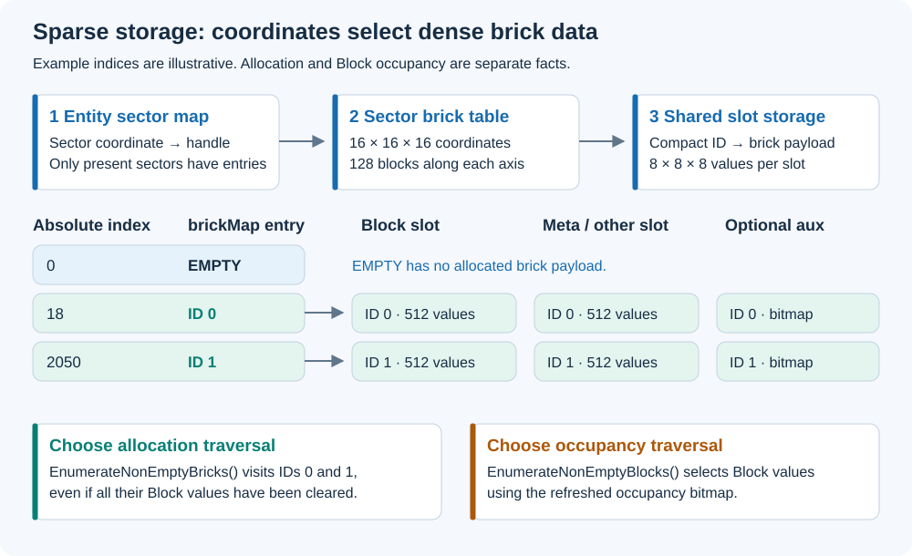

# The VDB-like voxel storage model

Status: Current implementation. Checked against Core `e5ead50` on 2026-09-06.

Caelix stores large voxel entities as a sparse map of sectors. A sector maps brick
coordinates to compact storage IDs, and each allocated brick stores a small dense
volume. This is the useful meaning of “VDB-like” here: a sparse hierarchy with
dense leaves. The implementation uses a fixed sector/brick layout; it does not
implement OpenVDB's tree, tiles, or file format.

## Follow a voxel through the hierarchy



*Figure 1. Coordinate-table indices and compact storage IDs serve different
purposes. An allocated brick can contain only empty Blocks.*

```text
VoxelEntityData
  sectors: entity-local sector coordinate -> SectorHandle
    Sector: 16 x 16 x 16 brick coordinates
      brickMap: absolute brick index -> compact brick ID, or EMPTY
        slot storage: compact brick ID -> 8 x 8 x 8 values
        optional aux: compact brick ID -> derived summary, such as a bitmap
```

| Level | Meaning |
|---|---|
| Entity | Has identity, rigid transform, and sparse sector maps. |
| Sector | Covers 128 blocks per axis and has 4,096 possible brick positions. |
| Brick | Covers 8 blocks per axis: 512 values per created slot. |
| Slot | A typed per-voxel data plane sharing the sector's brick IDs. |
| Aux buffer | Derived per-brick data associated with a slot, such as occupancy bits. |

The Block slot contains the visible voxel value. In this revision `Block.data`
is a `ushort` (16 bits). Metadata lives in a separate slot. Empty Block means
`data == 0`. Keep variable-length gameplay data outside voxel records.

## Coordinates and IDs

### Experimental packed scene materials

The `dev/astra/raw-color-materials` experiment selects its encoding at compile time.
Keep `CAELIX_PACKED_SCENE_COLOR` in `Runtime/BlockEncoding.cs` and Caelix's
`Runtime/Rendering/Shaders/def/CaelixMaterialConfig.hlsl` enabled together. Comment
out both defines to use regular block IDs. Restart with the matching scene data;
there is no runtime switch or additional encoding marker in `.cxw` files.

| Prefix | Remaining bits |
|---|---|
| `1` | RGB555, including opaque black. |
| `01` | RGB444 and two emission-strength bits (1, 8, 64, 512). |
| `00` | Six derived face bits and an eight-bit shared glass ID; ID zero is air. |

Canonical Block data stores glass IDs without face bits. The renderer adds faces
when preparing its data. The shared glass palette is generated from Caelix's
`Tools~/RawColor/glass-palette.json` for both C# and HLSL. Emission also has a global
shader multiplier, `CAELIX_PACKED_EMISSION_SCALE`. Packed mode disables world
automata because scene color values do not identify gameplay blocks.

Caelix's `Tools~/RawColor` exports native v6 `.cxw` saves directly from voxelized
source materials. Existing RGB-only VL32 files cannot recover lost emission or
glass properties. Keep generated scenes outside Unity package/project folders.

Entity-local voxel coordinates can be negative. Sector coordinates select the
sector; sector-local voxel coordinates range from 0 to 127. Brick coordinates
inside a sector range from 0 to 15. Voxel coordinates inside a brick range from
0 to 7. A voxel `(x, y, z)` occupies the unit box from that coordinate to the next
integer on each axis.

An **absolute brick index** addresses a position in the 4,096-entry sector table.
A **compact brick ID** addresses allocated slot data. They are different index
spaces. `SectorNonEmptyBrickEnumerator.BrickRef` exposes both as `BrickAbs` and
`Bid`. Use the conversion/access methods on `Sector`; use the
[enumerators](../reference/enumerators.md) for traversal.

For example, entity-local voxel `(-1, 0, 0)` lies in sector `(-1, 0, 0)` at
sector-local voxel `(127, 0, 0)`. Ordinary integer division that truncates toward
zero gives the wrong sector for this case. The existing entity accessors handle
the coordinate split.

Entities use translation and rotation with scale 1. A `VoxelEntityData` is a
Caelix storage object; it is not a Unity ECS `Entity`.

## Sparse allocation

Missing sectors and bricks read as empty through the appropriate entity/sector
accessors. Writing a default value to a missing brick does not allocate that
brick. A non-default write can allocate a brick and its required slot storage.
Every created slot uses the same compact brick ID space.

Clearing every Block in a brick does not automatically free the brick. Allocation
counts and `EnumerateNonEmptyBricks()` therefore describe allocated storage.
Other slots may also have data where Block is empty. Occupied Block traversal
uses a refreshed bitmap and has a different meaning from allocation traversal.

The sector still has a fixed coordinate table and flag arrays. Sparse leaf data
does not mean every operation scales only with occupied voxels: the current
allocated-brick enumerator scans the coordinate table internally.

## Ownership and snapshots

`SectorHandle` holds a pointer to a sector. Copies refer to the same allocation.
`VoxelEntityData` contains `SharedHashMap` values whose copies share the map
header. Copying these structs does not create independent storage. Copying an
entity also copies scalar fields, so orchestration code must write changed scalar
state back through the owning world API.

The owner must complete jobs before disposing or replacing storage. Never dispose
a borrowed handle or map. Do not retain brick pointers or enumerators across
allocation, snapshot application, entity replacement, or sector removal.

`VoxelEntityData.RemoveSectorAt` first marks the facing bricks of every surviving
neighbour sector dirty with `GeometryWithLocalNeighbor` and an empty direction
mask, so consumers that culled boundary data against the removed storage are
rescheduled by the next propagation and no sector is created.

`BrickBatchApplier` (`Runtime/Net/`) accepts unmanaged message payloads keyed by
brick and is the only apply path for replication. Its caller must keep each payload
alive until `Flush` returns. The applier validates every message before it changes
any brick, groups the records by the storage unit that owns them, applies different
units in parallel while keeping the wire order inside one unit, publishes a
`Removed` change entry per freed brick, frees a unit that ended up empty, and
refreshes `NonEmptyBricks` wherever allocation changed. It preserves slot strides,
render dirty flags and grow-only brick bounds. A malformed message changes no brick,
creates no storage, and reports an error code for the main thread.

During an active sector snapshot, normal reads use the live data and writes go
to the snapshot buffers. After scheduled work completes, applying the snapshot
commits the writes. This supports automata reading a stable state for the stage.
It does not make two jobs writing the same voxel safe.

Occupancy aux data must be refreshed after committed edits and local dirty
propagation. `VoxelEntityData.RefreshNonEmptyMask()` uses Geometry require-update
flags when an aux buffer already exists. Merely calling it after a raw write,
without the propagation phase, does not guarantee a changed mask is rebuilt.

## Implementation and validation

- [Sector constants and ownership](../../Runtime/Sector.cs)
- [Brick coordinate map](../../Runtime/SparseBrickIdTable.cs)
- [Slot storage and snapshot write selection](../../Runtime/Sector.Slots.cs)
- [Entity storage](../../Runtime/VoxelEntityData.cs), [shared maps](../../Runtime/SharedHashMap.cs)
- [Occupancy refresh](../../Runtime/VoxelEntityData.OccupancyMask.cs)
- [Storage tests](../../Tests/Editor/SectorStorageTests.cs), [snapshot tests](../../Tests/Editor/SectorSnapshotTests.cs), [coordinate tests](../../Tests/Editor/CoordinateAndNeighborhoodTests.cs)

This page was checked against source. The documentation pass did not rerun Unity tests.
